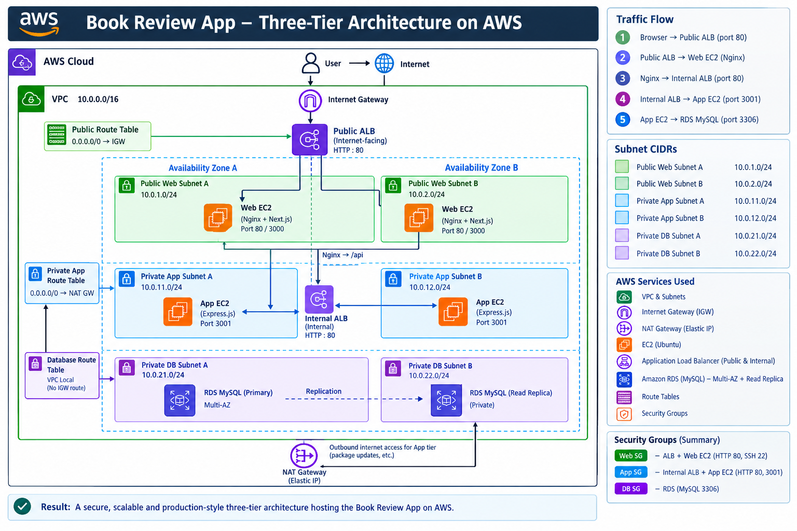
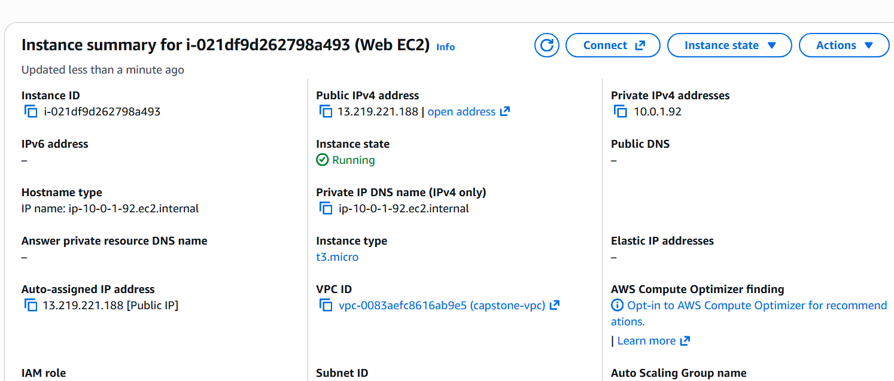
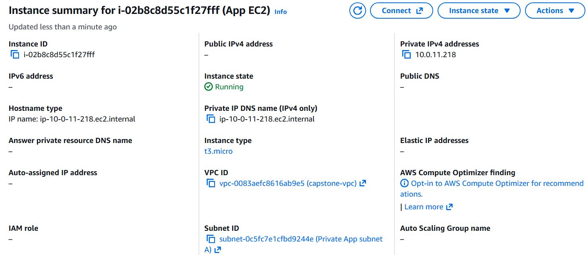
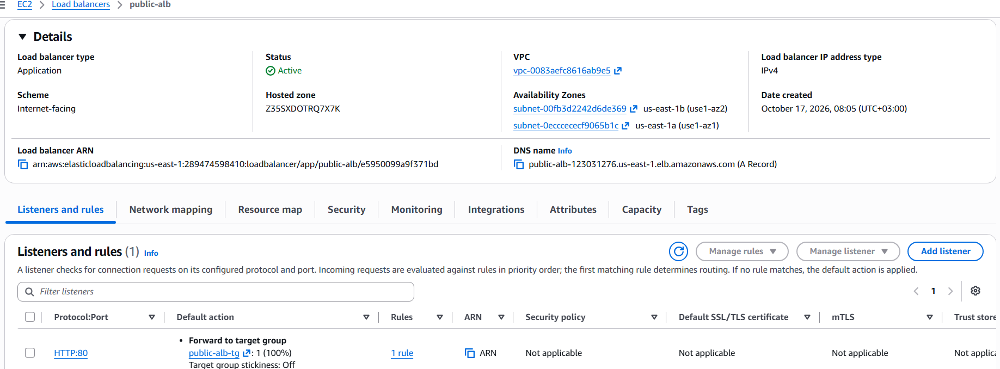
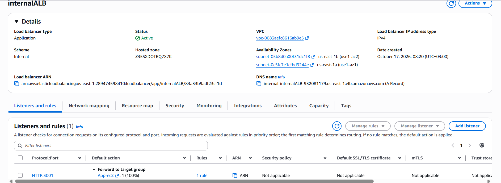
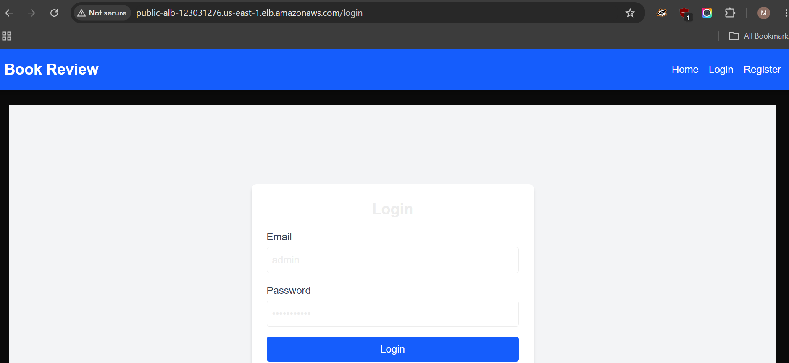
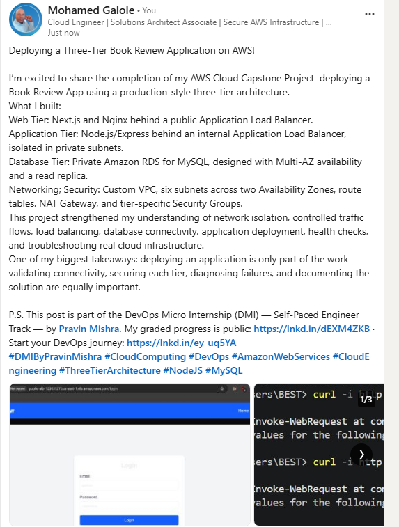

# Assignment 6 — Capstone Assignment — Deploy Book Review App (Three-Tier Architecture) on AWS

Part of the DevOps Micro Internship (DMI) Cohort 3 with Agentic AI

---

## Purpose

This is the most important assignment of the course. You will deploy the Book Review App in a fully production-style three-tier architecture on AWS: a Next.js Web Tier behind Nginx and a public ALB, a private Node.js/Express App Tier behind an internal ALB, and a private Multi-AZ MySQL RDS database with a read replica. You are expected to design, deploy, isolate, debug, and document the result independently.

---

# Task 1 — Architecture Diagram

## Goal

Create an architecture diagram showing the custom VPC (10.0.0.0/16), the six subnets across two Availability Zones (two public Web Tier, two private App Tier, two private Database Tier), the public ALB, Web Tier EC2/Nginx, internal ALB, private App Tier EC2, private Multi-AZ RDS with its read replica, and the permitted traffic flow.

### Evidence

#### Diagram image or link

---

# Task 2 — AWS Region & Services Used

## Goal

Record the AWS Region used and list every AWS service used across networking, compute, load balancing, security, and the database.

### Notes

**Region:**

Region: US East (N. Virginia) — us-east-1

---

**Services:**

EC2, VPC, ALB, RDS, Security Groups, Elastic IP'S, subnets, Internet Gateway, NAT Gateway, Route Tables, Ubuntu Linux, Nginx, Node.js, 
Next.js, MySQL, PM2, Git and GitHub
---

# Task 3 — Public Entry Point

## Goal

Confirm the Book Review App loads through the public ALB DNS name.

### Evidence

#### Public ALB DNS

public-alb-123031276.us-east-1.elb.amazonaws.com

`http://public-alb-123031276.us-east-1.elb.amazonaws.com`

---

# Task 4 — Evidence Screenshots

## Goal

Capture visual proof of every tier and load balancer.

### Evidence

#### Web EC2

---

#### App EC2

---

#### Public ALB

---

#### Internal ALB

---

#### RDS + Replica

Add your screenshot here.

---

#### App UI proof

---

# Task 5 — Summary

## Goal

Summarize what worked in the final deployment, the issues encountered and how each was fixed, and the tools or sources used to research and debug.

### Notes

**What worked:**

Successfully designed and deployed the Book Review App using a three-tier AWS architecture in the US East (N. Virginia) region (us-east-1). The architecture separated the presentation, application, and database tiers using a custom VPC with six subnets across two Availability Zones. The public Application Load Balancer provided the application entry point, while an internal ALB routed API traffic to the private Node.js/Express backend. The frontend used Next.js and Nginx, and Amazon RDS for MySQL provided database services with Multi-AZ and a read replica configured as part of the architecture. Security groups and route tables controlled communication between tiers, while PM2 supported application process management.

---

**Issues + fixes:**

Nginx configuration error: Nginx reported an unexpected end of file because of a syntax issue. Inspected the configuration, corrected the syntax, and used nginx -t to validate it before reloading the service.

Unhealthy ALB targets and 502 Bad Gateway: Investigated application availability, target group health checks, listener and target ports, security group rules, and the Nginx reverse-proxy configuration to identify connectivity issues.

Database initialization failure: The backend reported Unknown database 'book_review_db'. Identified the need to verify the RDS endpoint, database name, credentials, and database initialization before starting the application.

SSH access to the private App EC2: Configured SSH access through the public Web EC2 jump host and used SSH configuration to simplify connections to the private instance.

---

**Tools/sources used:**

AWS Management Console: VPC, EC2, Application Load Balancers, target groups, security groups, route tables, NAT Gateway, and Amazon RDS.

Ubuntu Linux terminal: Package installation, application deployment, service management, and troubleshooting.

Nginx: Reverse-proxy configuration and syntax validation.

Node.js, Express.js, Next.js, and PM2: Application runtime, frontend/backend deployment, and process management.

MySQL client: Database connectivity and database verification.

SSH: Secure access to EC2 instances.

GitHub: Application source repository and capstone assignment documentation.

AWS documentation and troubleshooting logs: Researching configuration options, diagnosing errors, and understanding AWS resource behavior.

---

# LinkedIn Post (Required)

## Goal

Publish a LinkedIn post sharing the capstone deployment, including the public ALB DNS (or a redacted screenshot), three to five lines on what you built and why it is production-style, and one proof screenshot.

## Evidence

#### LinkedIn Post URL

Paste your LinkedIn post URL here:

`https://lnkd.in/p/exP87kgS`

---

#### Screenshot of LinkedIn post

---

# Submission Instructions

- Add all required screenshots and links in your submission
- Do not expose passwords, RDS credentials, connection strings, private keys, or account IDs

---

# Completion Checklist

- [ ] Task 1: Architecture diagram completed
- [ ] Task 2: AWS Region and services documented
- [ ] Task 3: Public ALB DNS confirmed working
- [ ] Task 4: All six evidence screenshots captured (Web Tier, App Tier, both ALBs, RDS + replica, app UI)
- [ ] Task 5: Deployment summary completed (what worked, issues/fixes, tools/sources)
- [ ] LinkedIn post published and URL submitted
- [ ] App Tier and Database Tier confirmed not publicly accessible
- [ ] No sensitive data exposed

---

## 📌 About DMI & CloudAdvisory

DevOps Micro Internship (DMI) is a project-based DevOps program run by Pravin Mishra (The CloudAdvisory) focused on real-world execution, systems thinking, and career readiness.

It helps learners build strong DevOps foundations with hands-on experience.

---

## 📌 Resources

- 🌐 DMI Official Website: https://dmi.pravinmishra.com?utm_source=github&utm_medium=readme  
- 🎓 University: https://university.pravinmishra.com?utm_source=github&utm_medium=readme  
- 💬 Discord Community: https://discord.pravinmishra.com?utm_source=github&utm_medium=readme  
- 📝 Blog: https://dmi.pravinmishra.com/blog?utm_source=github&utm_medium=readme  
- ▶️ YouTube Playlist: https://www.youtube.com/playlist?list=PLFeSNDtI4Cho  
- 🔗 Pravin Mishra (LinkedIn): https://www.linkedin.com/in/pravin-mishra-aws-trainer/  
- 🏢 CloudAdvisory (LinkedIn): https://www.linkedin.com/company/thecloudadvisory/

---

*This submission is part of DevOps Micro Internship (DMI) Cohort 3 — Agentic AI Track.*